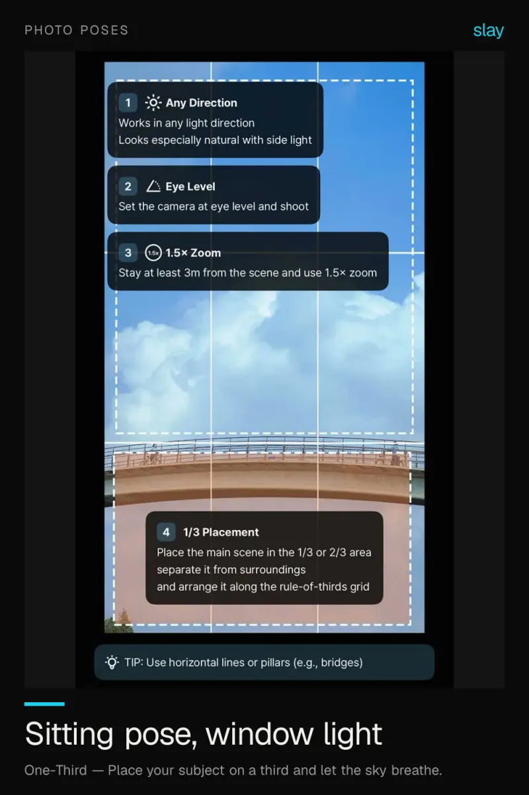

# Photo ideas — 41 iPhone photo ideas with the composition to use

41 photo ideas for iPhone across 8 topics — café, travel, poses,
aesthetic, Instagram and Japanese-style shots. Each idea says **which composition to use**,
so you know where to put the subject before you press the shutter. For step-by-step
setups (height, angle, zoom, distance), pair them with
[composition-guides](https://github.com/slaycamera/composition-guides).

Made by **slay**, the composition-guide camera for iPhone. Free under
[CC BY 4.0](LICENSE) — credit **slay — [slaycamera.com](https://www.slaycamera.com/?utm_source=github&utm_medium=repo&utm_campaign=photo-ideas)**.

## Topics

| Topic | Ideas | What's inside |
|---|---|---|
| [iPhone Photo Ideas](topics/iphone-photo-ideas.md) | 6 | Photo ideas that need nothing but the phone in your pocket. |
| [Photo Poses](topics/photo-poses.md) | 4 | Most stiff posing is a framing problem, not a posing problem. |
| [Aesthetic Photo Ideas](topics/aesthetic-photo-ideas.md) | 5 | Aesthetic photos come from restraint. |
| [Instagram Photo Ideas](topics/instagram-photo-ideas.md) | 5 | A good photo dump needs variety, not ten near-duplicates. |
| [How to Take Better iPhone Photos](topics/better-iphone-photos.md) | 6 | Modern iPhone cameras are excellent. |
| [Photo Composition Ideas](topics/photo-composition-ideas.md) | 6 | Composition is the highest-leverage skill in photography. |
| [Japanese Photography Aesthetic](topics/japanese-photography.md) | 3 | Low contrast, lots of air, one small subject. |
| [Travel / Cafe Photo Ideas](topics/cafe-photography.md) | 6 | Cafes hand you the set for free: a ledge, a window, a clean table. |

## A few to start with

### iPhone Photo Ideas: Sunset Fairground With One Subject

A single figure against a big sky turns a snapshot into a scene. Place the person small, keep the horizon low. → [iPhone Photo Ideas](topics/iphone-photo-ideas.md)

### Photo Poses: The Seated Window Pose That Always Works

Seat your subject side-on to a window, put their eye line on the top third and leave room in front of them. → [Photo Poses](topics/photo-poses.md)

### Minimal Aesthetic Photo Ideas: One Colour, Maximum Mood

Pick one colour and commit. A tight palette with lots of empty space reads as styled, not accidental. → [Aesthetic Photo Ideas](topics/aesthetic-photo-ideas.md)

### Instagram Photo Dump Ideas: 5 Cafe Shots to Copy

A photo dump needs variety, not ten near-duplicates. Here are five different framings of the same cafe table. → [Instagram Photo Ideas](topics/instagram-photo-ideas.md)

## Use the data

[`data/photo-ideas.json`](data/photo-ideas.json) lists every topic and idea with its
description, keywords, image path and the composition principle behind it.

## Related

- [composition-guides](https://github.com/slaycamera/composition-guides) — the 14 composition recipes these ideas use, with diagrams and settings
- [luts](https://github.com/slaycamera/luts) — free cinematic LUTs to finish the look
- [Photo ideas on slaycamera.com](https://www.slaycamera.com/photo-ideas?utm_source=github&utm_medium=repo&utm_campaign=photo-ideas)
- [Download slay on the App Store](https://apps.apple.com/app/id6807513456?utm_source=github&utm_medium=repo&utm_campaign=photo-ideas)

## Attribution

> Photo ideas: [slay](https://www.slaycamera.com/?utm_source=github&utm_medium=repo&utm_campaign=photo-ideas) (CC BY 4.0)

## License

Text, data and images are released under the
[Creative Commons Attribution 4.0 International license](LICENSE) (CC BY 4.0).
