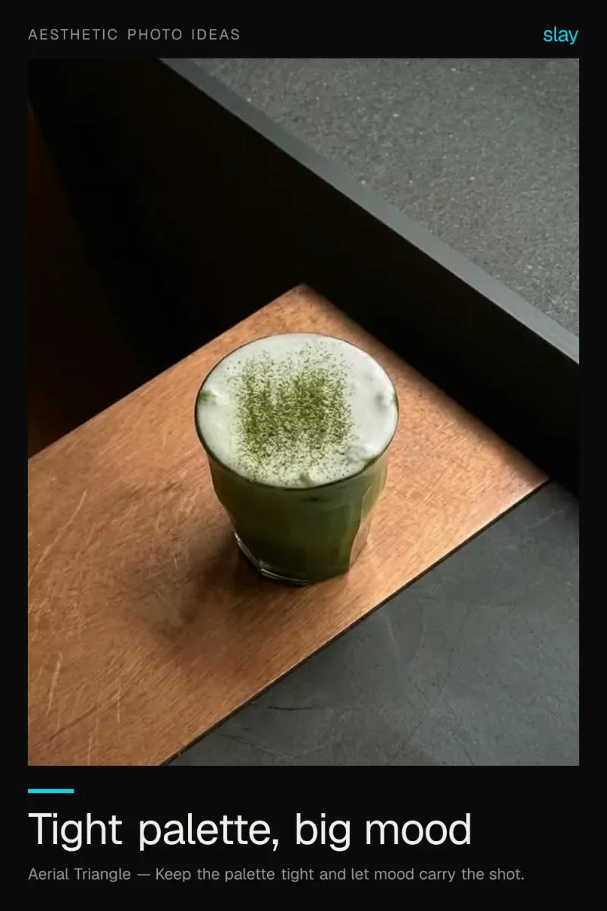
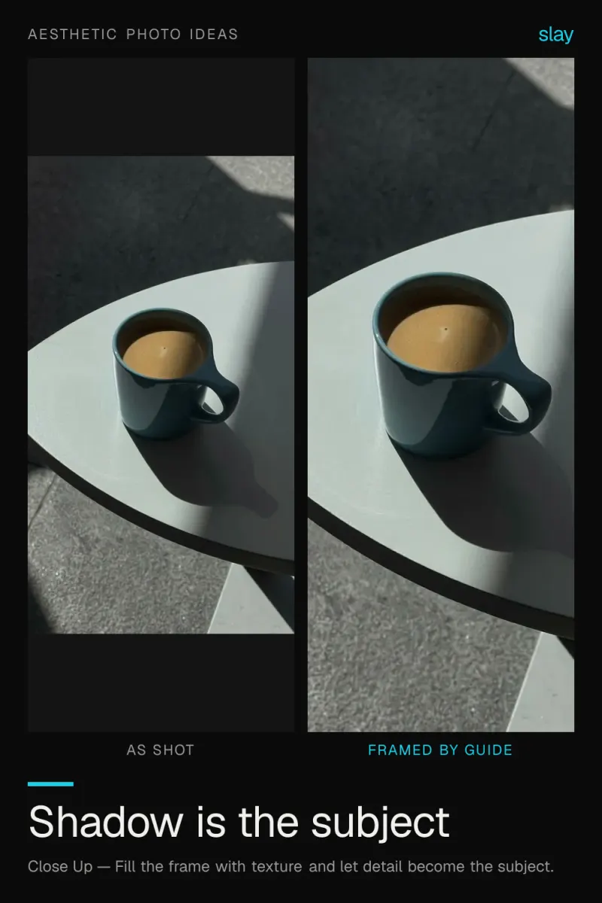
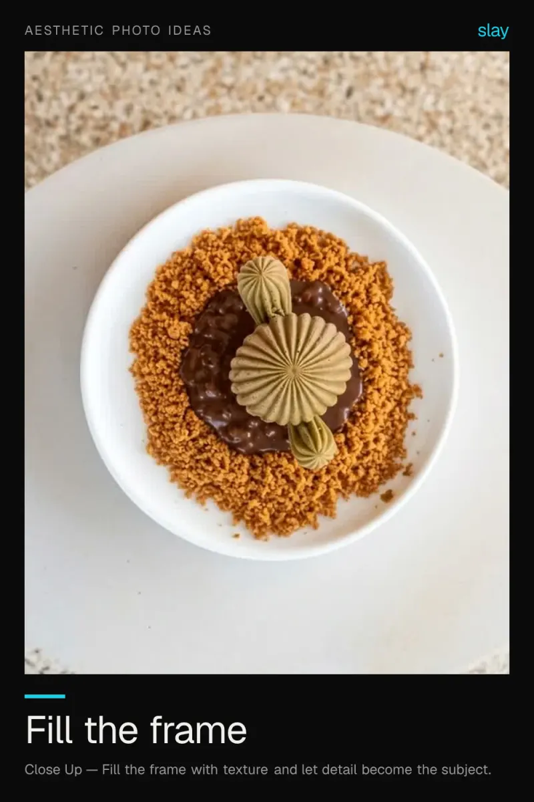
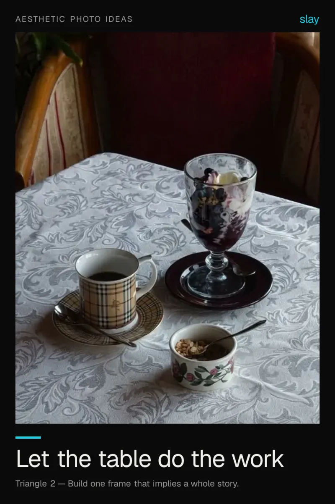
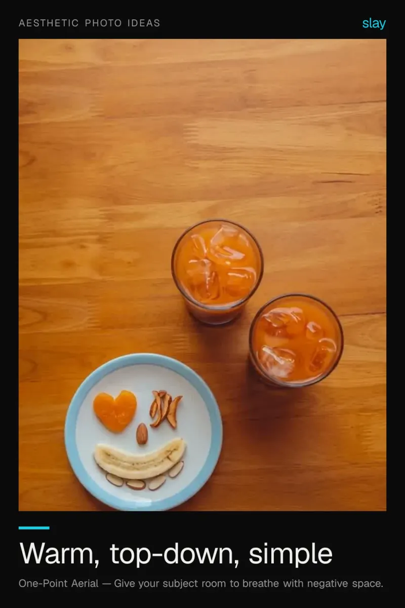

# Aesthetic photo ideas: one colour, one mood

Aesthetic photos come from restraint. Pick a tight palette, find a clean surface, and let empty space do the work instead of filling the frame.

5 ideas · from [slay](https://www.slaycamera.com/photo-ideas/aesthetic-photo-ideas?utm_source=github&utm_medium=repo&utm_campaign=photo-ideas) · CC BY 4.0

## 1. Minimal Aesthetic Photo Ideas: One Colour, Maximum Mood

Pick one colour and commit. A tight palette with lots of empty space reads as styled, not accidental.

**Composition:** Keep the palette tight and let mood carry the shot.

## 2. Aesthetic Coffee Photos: Let the Shadow In

Hard light and a clean surface turn a cup into a graphic. Shoot the shadow as much as the coffee.

**Composition:** Fill the frame with texture and let detail become the subject.

## 3. Food Aesthetic Photos: Fill the Frame and Lose the Noise

Sometimes the only thing a photo needs is less distance. Get close, commit to the texture, drop the background.

**Composition:** Fill the frame with texture and let detail become the subject.

## 4. Vintage Aesthetic Photo Ideas: Textured Tables and Teacups

A patterned cloth gives a plain subject a mood. Find texture first, then put something simple on top of it.

**Composition:** Build one frame that implies a whole story.

## 5. Warm Aesthetic Photo Ideas: Fruits, Wood and Daylight

Wood plus daylight plus one bright colour is the whole recipe. Shoot straight down and leave space at the edge.

**Composition:** Give your subject room to breathe with negative space.

---

More: [Aesthetic Photo Ideas on slaycamera.com](https://www.slaycamera.com/photo-ideas/aesthetic-photo-ideas?utm_source=github&utm_medium=repo&utm_campaign=photo-ideas) ·
[All topics](../README.md) ·
[Frame these live with slay](https://apps.apple.com/app/id6807513456?utm_source=github&utm_medium=repo&utm_campaign=photo-ideas)
