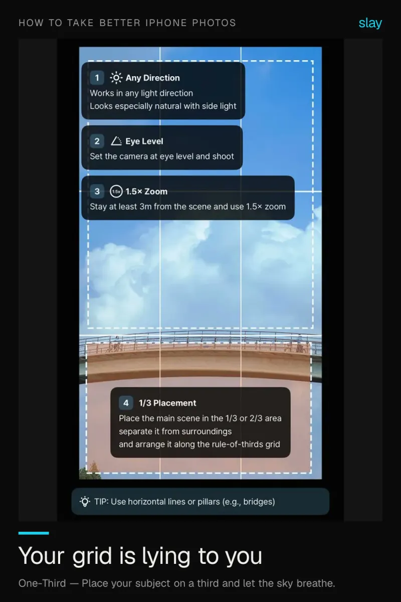
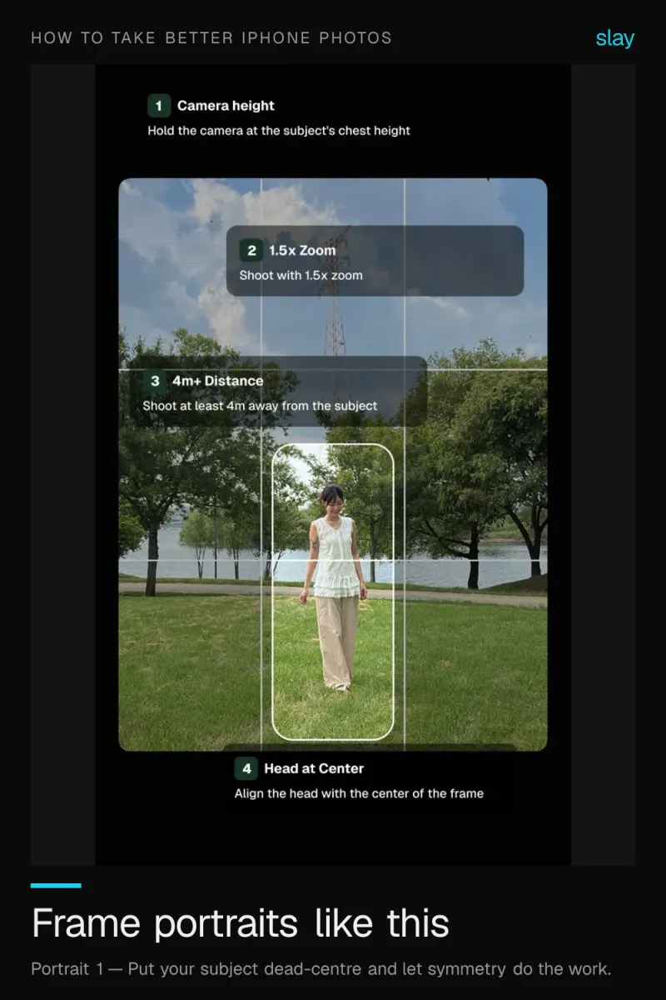
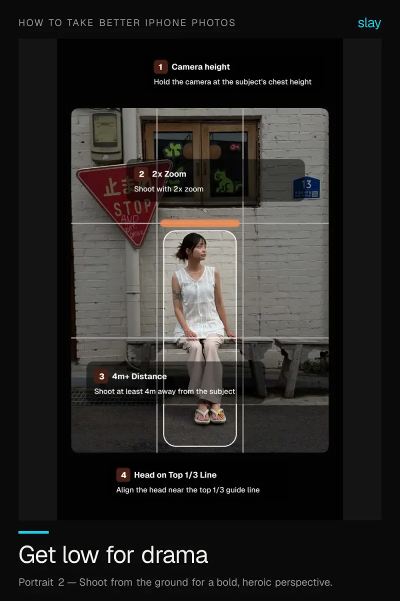
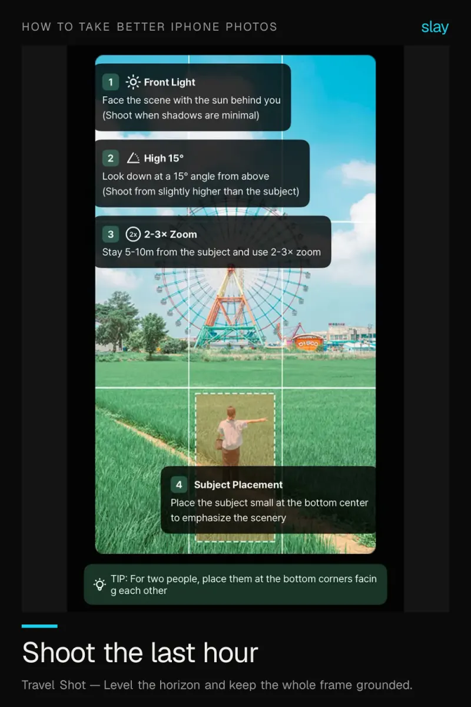
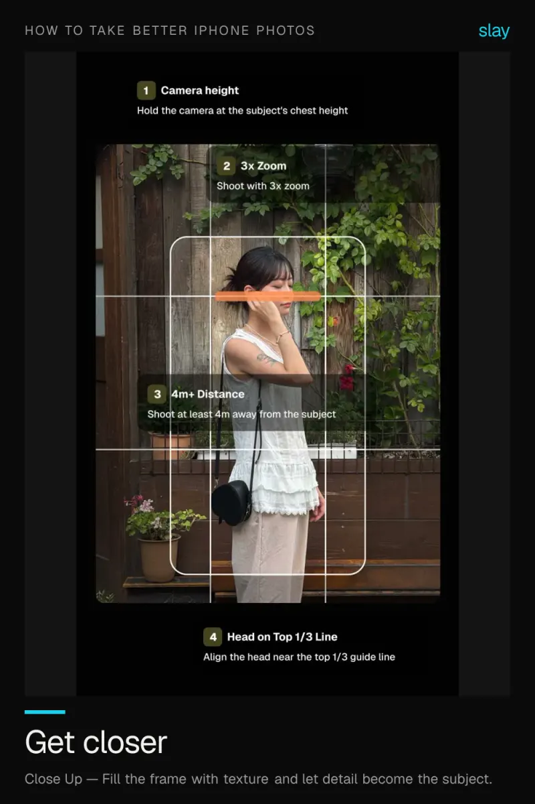

# How to take better iPhone photos

Modern iPhone cameras are excellent. Most weak photos are a composition problem, not a sensor problem — and composition is learnable in a few weeks of deliberate practice.

6 ideas · from [slay](https://www.slaycamera.com/photo-ideas/better-iphone-photos?utm_source=github&utm_medium=repo&utm_campaign=photo-ideas) · CC BY 4.0

## 1. How to Take Better iPhone Photos: Beyond the Camera Grid

The stock grid marks the thirds but teaches you nothing else. Real composition guidance shows you where to put the subject.

**Composition:** Place your subject on a third and let the sky breathe.

## 2. How to Take Better iPhone Portraits: Framing First

Sharp and well-lit is not the same as well-framed. Put the subject on a line, keep the eyes high, leave looking room.

**Composition:** Put your subject dead-centre and let symmetry do the work.

## 3. Low Angle Photography on iPhone: Go Bold, Go Heroic

Drop the phone near the ground and tilt up. Full body shots lengthen and everyday scenes turn heroic.

**Composition:** Shoot from the ground for a bold, heroic perspective.

## 4. Stop Digital Zooming: Move Your Feet Instead

Digital zoom softens an image. Use your feet or the iPhone's native lenses and your photos stay sharp.

**Composition:** Anchor your subject in the lower two-thirds to add depth.

## 5. Golden Hour iPhone Photography: Timing and Framing

Warm, low, directional light flatters everything. Be in position 60-90 minutes before sunset and compose before the light peaks.

**Composition:** Level the horizon and keep the whole frame grounded.

## 6. Close-Up Photography on iPhone: Texture Is the Subject

One second of walking closer improves a photo more than any edit. Fill the frame and let detail carry it.

**Composition:** Fill the frame with texture and let detail become the subject.

---

More: [How to Take Better iPhone Photos on slaycamera.com](https://www.slaycamera.com/photo-ideas/better-iphone-photos?utm_source=github&utm_medium=repo&utm_campaign=photo-ideas) ·
[All topics](../README.md) ·
[Frame these live with slay](https://apps.apple.com/app/id6807513456?utm_source=github&utm_medium=repo&utm_campaign=photo-ideas)
