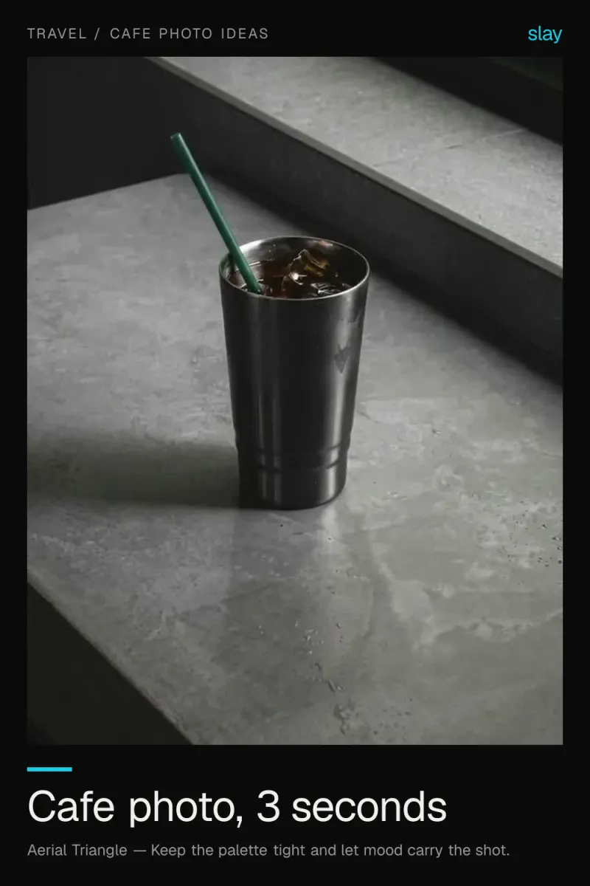
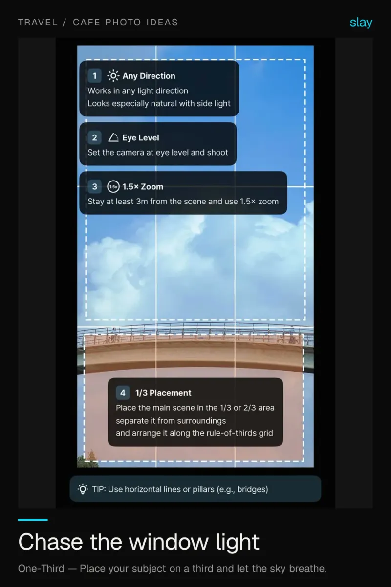
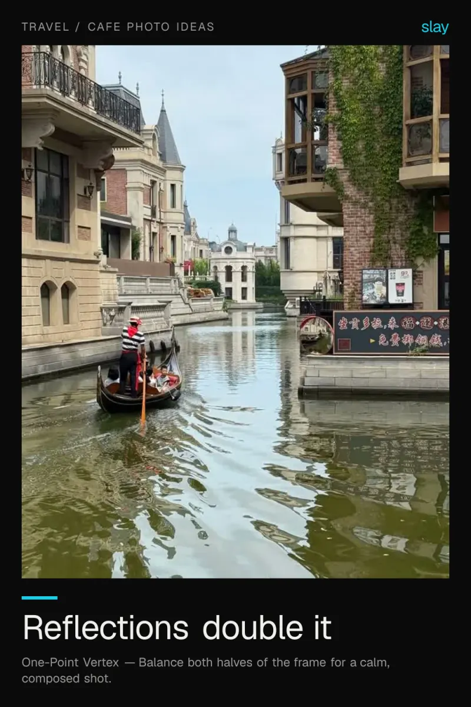
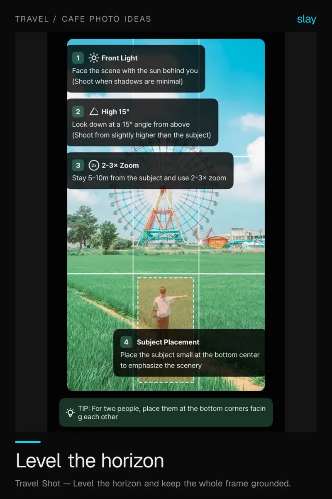
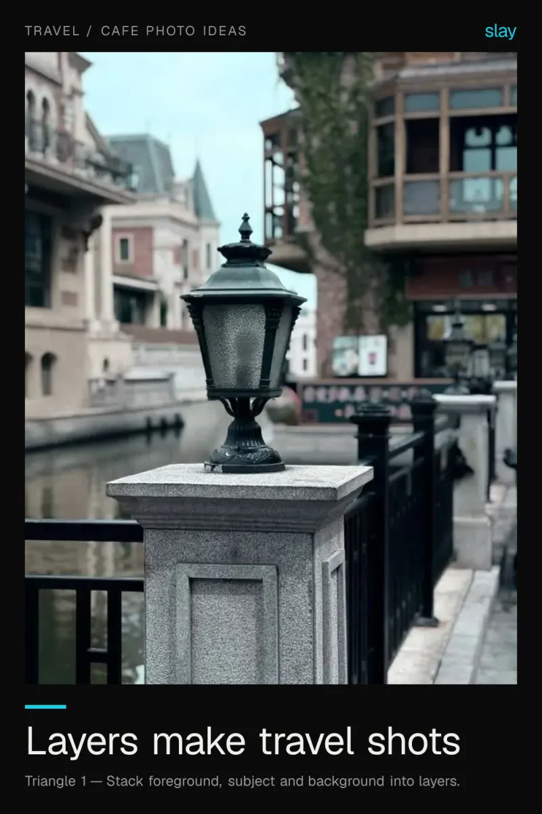

# Cafe and travel photo ideas for iPhone

Cafes hand you the set for free: a ledge, a window, a clean table. Travel photography is the same skill pointed at a street instead of a cup.

6 ideas · from [slay](https://www.slaycamera.com/photo-ideas/cafe-photography?utm_source=github&utm_medium=repo&utm_campaign=photo-ideas) · CC BY 4.0

## 1. How to Take Better Cafe Photos on iPhone

Cafe shots live or die on the frame, not the coffee. Put the cup off-centre, find clean light, and shoot.

**Composition:** Keep the palette tight and let mood carry the shot.

## 2. Coffee Flatlay Ideas: Overhead Photos That Look Intentional

Shoot straight down, leave one empty corner, and let the table texture do the work. Simple beats busy.

**Composition:** Fill the frame with texture and let detail become the subject.

## 3. Cafe Photo Ideas: Use Window Light Like a Pro

Sit beside the window, not opposite it. Side light shapes a subject; flat front light makes it look dull.

**Composition:** Place your subject on a third and let the sky breathe.

## 4. Travel Photo Ideas: Reflections That Double the Scene

Water, glass and wet streets give you instant symmetry. Shoot along the reflection, not across it.

**Composition:** Balance both halves of the frame for a calm, composed shot.

## 5. Travel Photography Tip: A Level Horizon Fixes Everything

A tilted horizon unsettles a landscape even when nobody can say why. Level it and place it on a third line.

**Composition:** Level the horizon and keep the whole frame grounded.

## 6. Layered Travel Photos: Foreground, Subject, Background

Stack a foreground, a subject and a background and the eye travels in stages. Depth is what makes travel shots feel cinematic.

**Composition:** Stack foreground, subject and background into layers.

---

More: [Travel / Cafe Photo Ideas on slaycamera.com](https://www.slaycamera.com/photo-ideas/cafe-photography?utm_source=github&utm_medium=repo&utm_campaign=photo-ideas) ·
[All topics](../README.md) ·
[Frame these live with slay](https://apps.apple.com/app/id6807513456?utm_source=github&utm_medium=repo&utm_campaign=photo-ideas)
