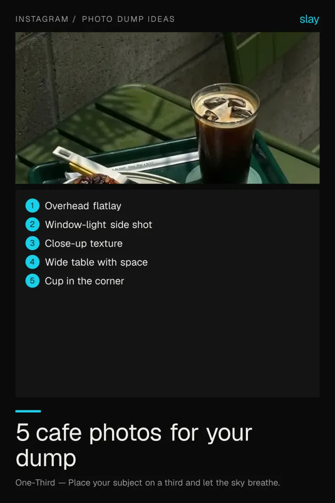
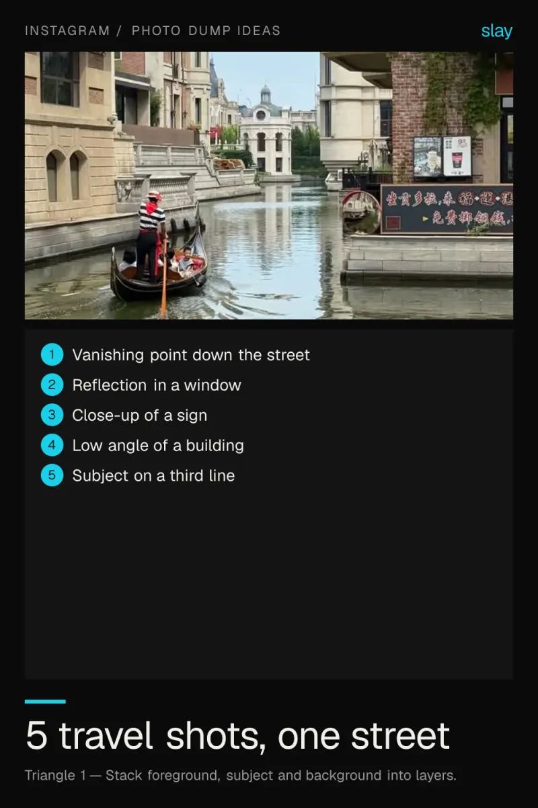
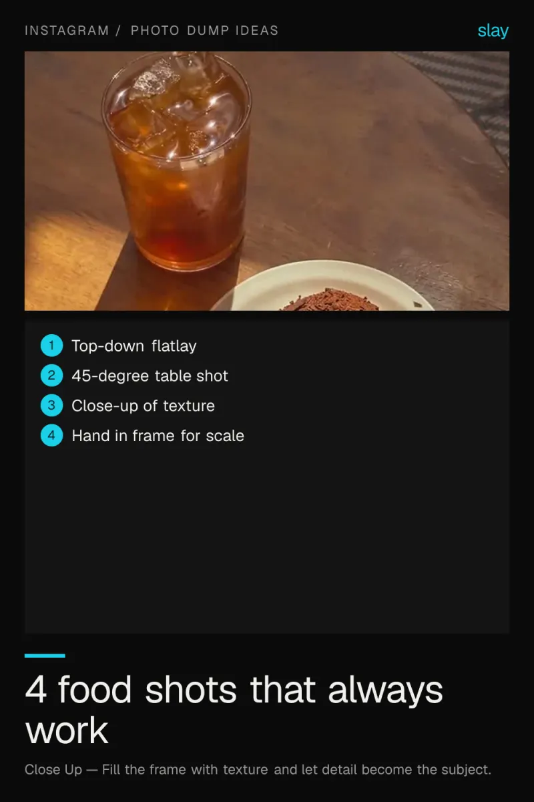
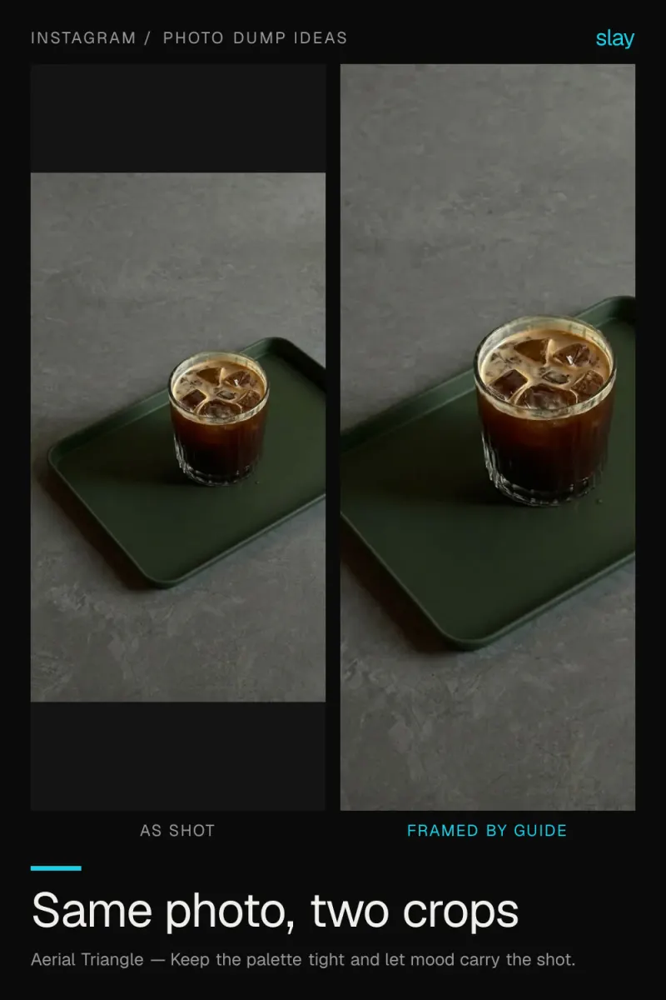
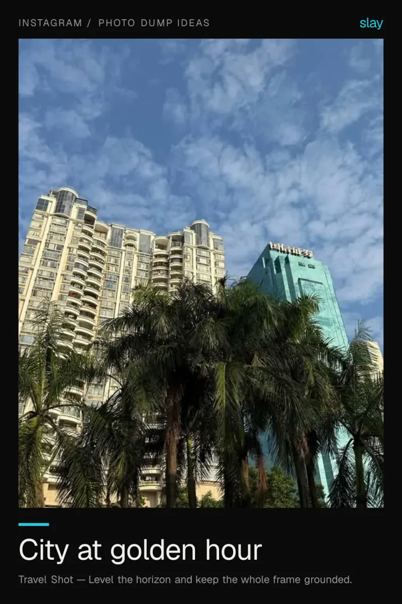

# Instagram photo ideas for your next dump

A good photo dump needs variety, not ten near-duplicates. One location can fill a whole post if you change the framing between shots.

5 ideas · from [slay](https://www.slaycamera.com/photo-ideas/instagram-photo-ideas?utm_source=github&utm_medium=repo&utm_campaign=photo-ideas) · CC BY 4.0

## 1. Instagram Photo Dump Ideas: 5 Cafe Shots to Copy

A photo dump needs variety, not ten near-duplicates. Here are five different framings of the same cafe table.

- Overhead flatlay
- Window-light side shot
- Close-up texture
- Wide table with space
- Cup in the corner

**Composition:** Place your subject on a third and let the sky breathe.

## 2. Travel Photo Dump Ideas: 5 Shots From One Street

One location can fill a whole photo dump if you change the framing. Here are five compositions from a single walk.

- Vanishing point down the street
- Reflection in a window
- Close-up of a sign
- Low angle of a building
- Subject on a third line

**Composition:** Stack foreground, subject and background into layers.

## 3. Food Photo Dump Ideas: 4 Framings for Any Meal

The same plate can look like four different photos. Here is how to vary a meal for a photo dump.

- Top-down flatlay
- 45-degree table shot
- Close-up of texture
- Hand in frame for scale

**Composition:** Fill the frame with texture and let detail become the subject.

## 4. Instagram Grid Ideas: One Photo, Two Very Different Posts

Cropping is composition, not editing. See what changes when the same frame is tightened to a guide.

**Composition:** Keep the palette tight and let mood carry the shot.

## 5. City Photo Ideas: Golden Hour From Any Rooftop

Cities photograph best in the hour before sunset. Find height, find a clean edge, and let the light do the rest.

**Composition:** Level the horizon and keep the whole frame grounded.

---

More: [Instagram Photo Ideas on slaycamera.com](https://www.slaycamera.com/photo-ideas/instagram-photo-ideas?utm_source=github&utm_medium=repo&utm_campaign=photo-ideas) ·
[All topics](../README.md) ·
[Frame these live with slay](https://apps.apple.com/app/id6807513456?utm_source=github&utm_medium=repo&utm_campaign=photo-ideas)
