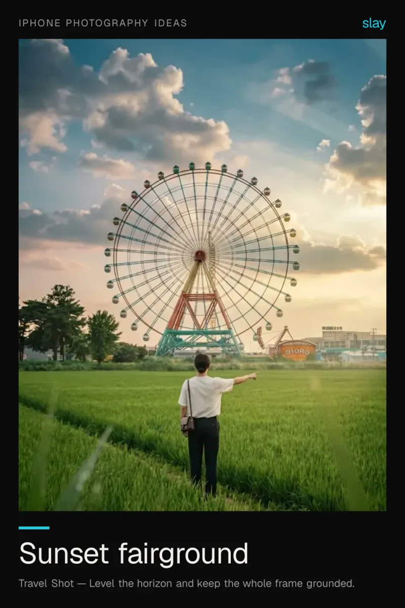
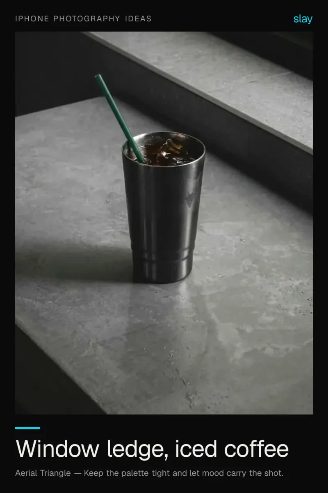
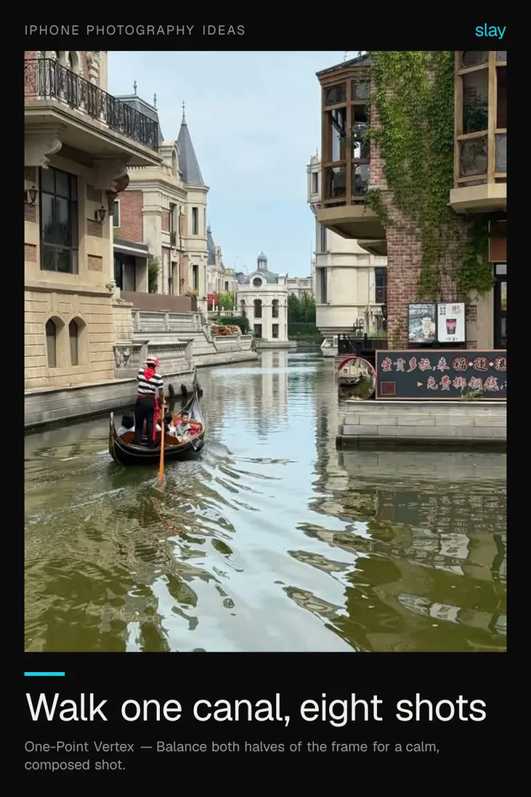
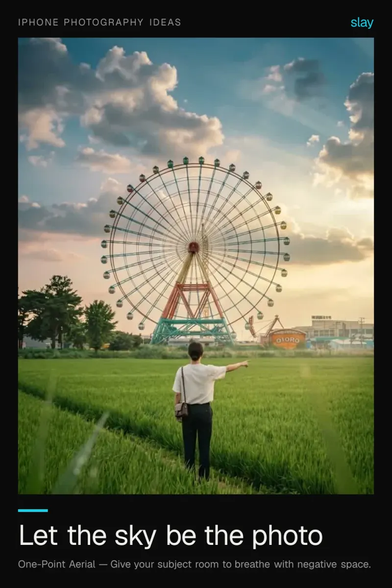
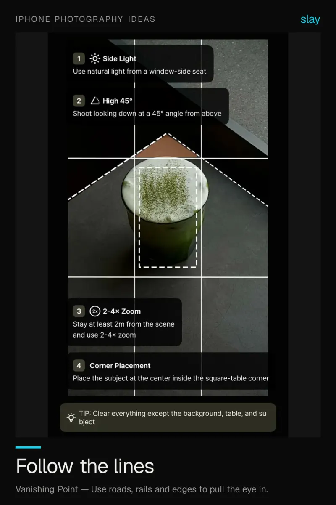

# iPhone photo ideas you can shoot today

Photo ideas that need nothing but the phone in your pocket. Each one is a composition decision, not a piece of gear — put the subject on a third, find the light, keep the edges clean.

6 ideas · from [slay](https://www.slaycamera.com/photo-ideas/iphone-photo-ideas?utm_source=github&utm_medium=repo&utm_campaign=photo-ideas) · CC BY 4.0

## 1. iPhone Photo Ideas: Sunset Fairground With One Subject

A single figure against a big sky turns a snapshot into a scene. Place the person small, keep the horizon low.

**Composition:** Level the horizon and keep the whole frame grounded.

## 2. iPhone Photo Ideas: The Window Ledge Coffee Shot

Cafes hand you the set for free. Use the ledge, the frame edge and daylight, and shoot down the line.

**Composition:** Keep the palette tight and let mood carry the shot.

## 3. iPhone Photo Ideas: A Canal Walk Photo Series

Pick a route, not a subject. Reflections, bridges and doorways give you a whole series in twenty minutes.

**Composition:** Balance both halves of the frame for a calm, composed shot.

## 4. iPhone Photo Ideas: Minimal Photos on Grey Days

Flat light is not bad light. Pair one subject with one clean surface and the grey becomes the aesthetic.

**Composition:** Give your subject room to breathe with negative space.

## 5. iPhone Photo Ideas: When the Sky Is the Subject

Some days the clouds are the shot. Expose for the sky, put the horizon on the bottom third and keep the land small.

**Composition:** Give your subject room to breathe with negative space.

## 6. iPhone Photo Ideas: Street Lines That Do the Work

Roads, railings and curbs already point somewhere. Find the line, then stand so it leads into the frame.

**Composition:** Use roads, rails and edges to pull the eye in.

---

More: [iPhone Photo Ideas on slaycamera.com](https://www.slaycamera.com/photo-ideas/iphone-photo-ideas?utm_source=github&utm_medium=repo&utm_campaign=photo-ideas) ·
[All topics](../README.md) ·
[Frame these live with slay](https://apps.apple.com/app/id6807513456?utm_source=github&utm_medium=repo&utm_campaign=photo-ideas)
