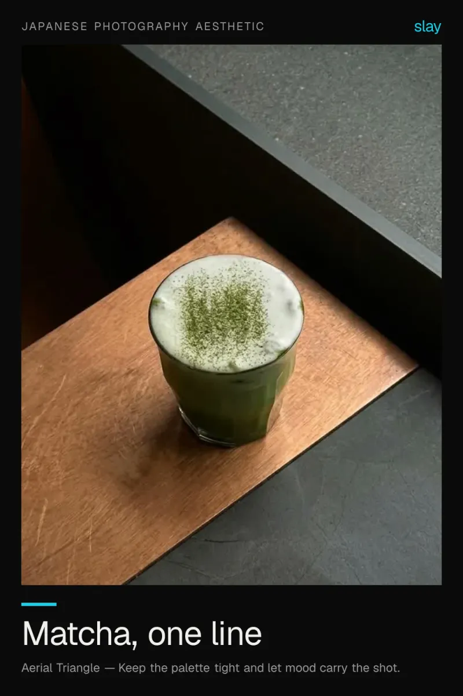
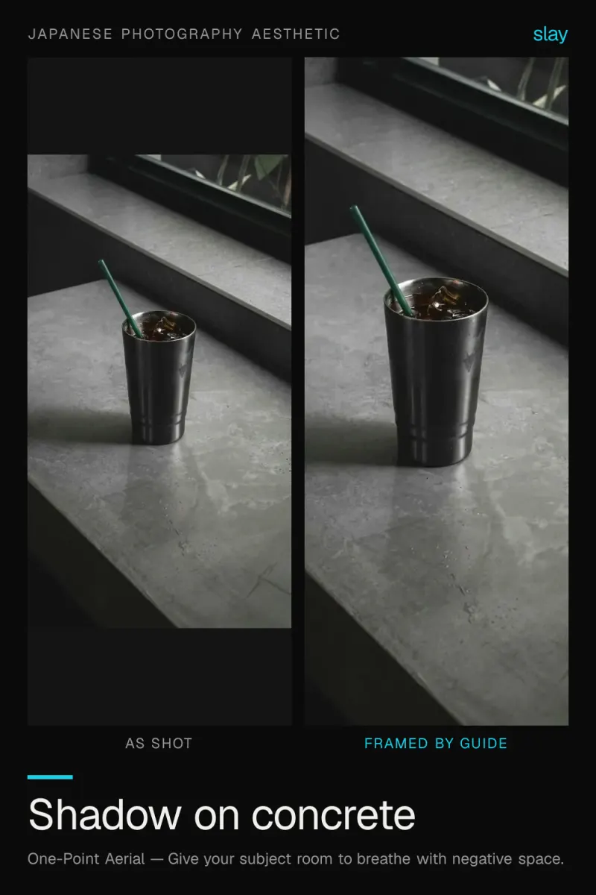
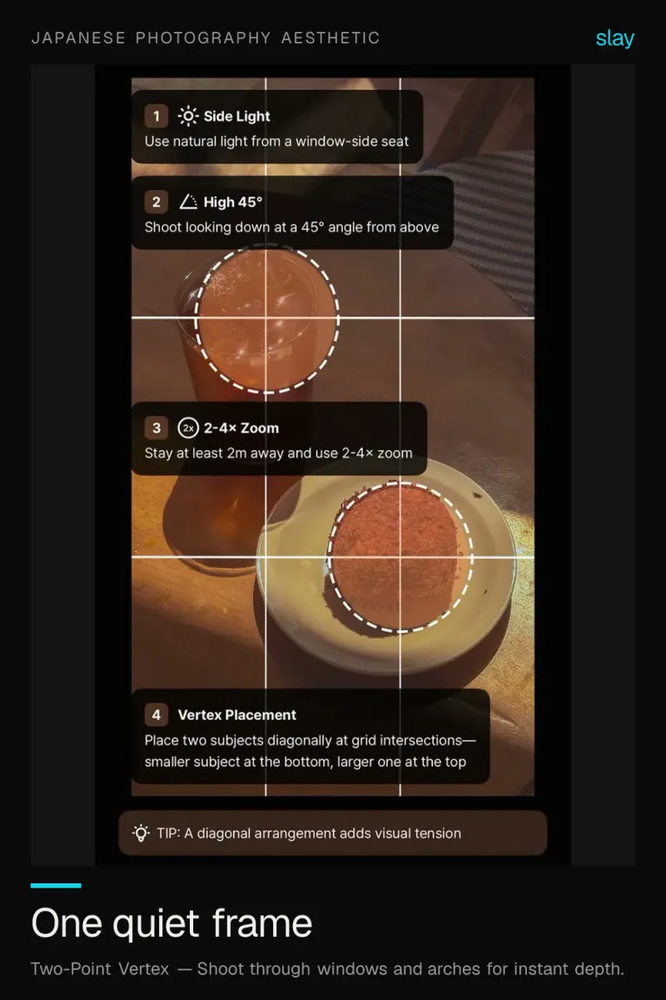

# Japanese photography aesthetic: quiet, empty, deliberate

Low contrast, lots of air, one small subject. This style is about what you leave out — the empty space sets the tone, so resist filling it.

3 ideas · from [slay](https://www.slaycamera.com/photo-ideas/japanese-photography?utm_source=github&utm_medium=repo&utm_campaign=photo-ideas) · CC BY 4.0

## 1. Japanese Photography Aesthetic: Minimal Matcha Photo Ideas

Quiet, empty and deliberate. One subject, one diagonal, almost nothing else in the frame.

**Composition:** Keep the palette tight and let mood carry the shot.

## 2. Japanese Photography Aesthetic: Light and Shadow on Grey

Hard daylight across a plain surface is a whole genre. Shoot the shadow as the subject.

**Composition:** Give your subject room to breathe with negative space.

## 3. Japanese Photography Aesthetic: The Quiet Street Frame

Low contrast, lots of air, one small subject. Let the empty space set the tone instead of filling it.

**Composition:** Shoot through windows and arches for instant depth.

---

More: [Japanese Photography Aesthetic on slaycamera.com](https://www.slaycamera.com/photo-ideas/japanese-photography?utm_source=github&utm_medium=repo&utm_campaign=photo-ideas) ·
[All topics](../README.md) ·
[Frame these live with slay](https://apps.apple.com/app/id6807513456?utm_source=github&utm_medium=repo&utm_campaign=photo-ideas)
