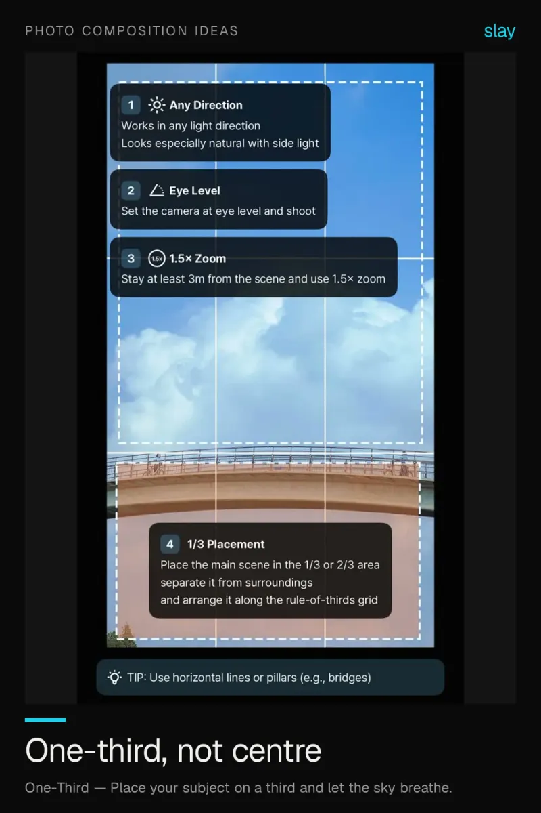
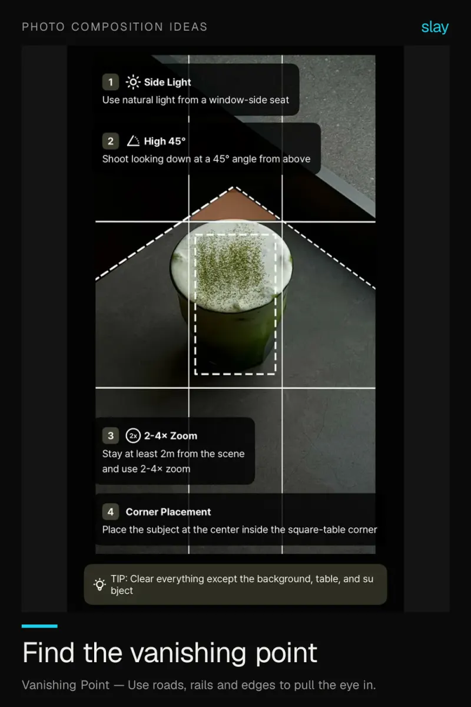
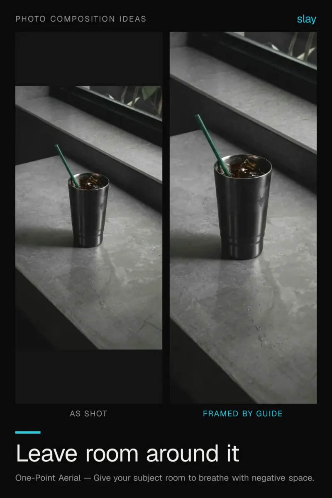
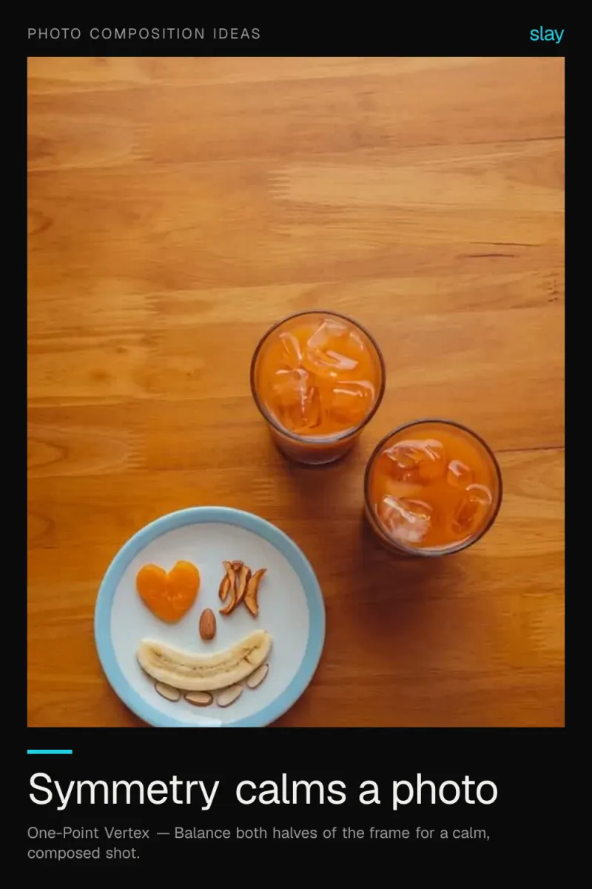
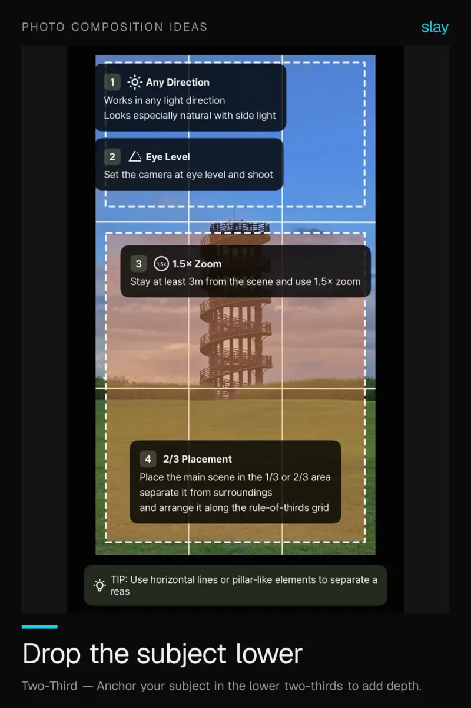
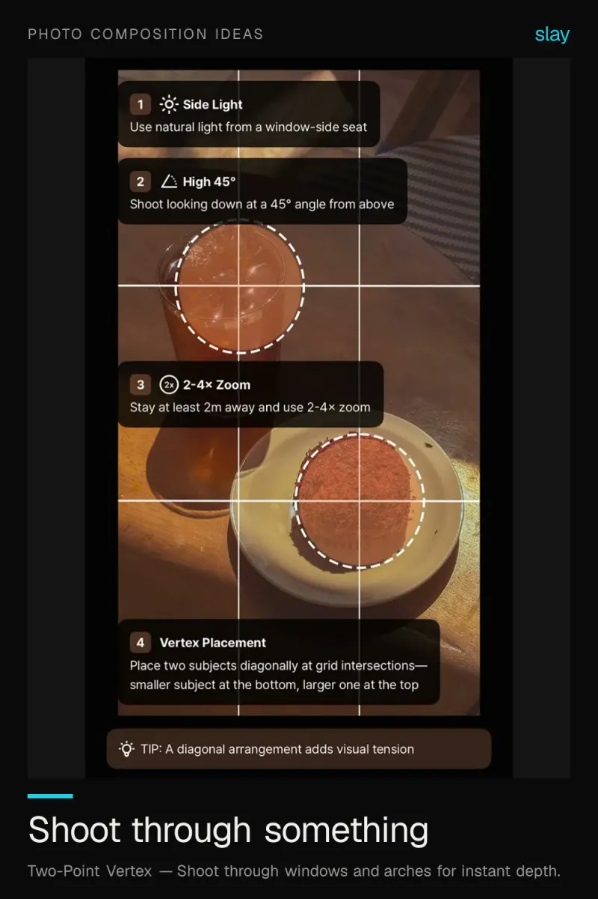

# Photo composition ideas that always work

Composition is the highest-leverage skill in photography. A cheap camera with great framing beats a great camera with bad framing every time.

6 ideas · from [slay](https://www.slaycamera.com/photo-ideas/photo-composition-ideas?utm_source=github&utm_medium=repo&utm_campaign=photo-ideas) · CC BY 4.0

## 1. iPhone Photo Ideas: The One-Third Rule for Cafe Photos

Place your subject on a third line instead of dead centre and a cafe shot stops looking accidental.

**Composition:** Place your subject on a third and let the sky breathe.

## 2. Vanishing Point Photography: How to Add Instant Depth

Roads, rails and hallways pull the eye straight into the frame. Find converging lines and place the point on a third.

**Composition:** Use roads, rails and edges to pull the eye in.

## 3. Negative Space Photo Ideas: Let a Simple Subject Breathe

A small subject on a big clean background reads as intentional. Give it space instead of filling the frame.

**Composition:** Give your subject room to breathe with negative space.

## 4. Symmetry in Photography: Calm, Composed iPhone Photos

Balance both halves of the frame and a busy scene reads as orderly. Look for reflections and repeated shapes.

**Composition:** Balance both halves of the frame for a calm, composed shot.

## 5. The Two-Third Rule: Anchor Your Subject for More Depth

Placing a subject in the lower two-thirds adds foreground and makes a flat scene feel dimensional.

**Composition:** Anchor your subject in the lower two-thirds to add depth.

## 6. Frame Within a Frame: Depth on iPhone in One Move

Tripod? No. Shoot through a window, doorway or arch and the opening becomes a spotlight on your subject.

**Composition:** Shoot through windows and arches for instant depth.

---

More: [Photo Composition Ideas on slaycamera.com](https://www.slaycamera.com/photo-ideas/photo-composition-ideas?utm_source=github&utm_medium=repo&utm_campaign=photo-ideas) ·
[All topics](../README.md) ·
[Frame these live with slay](https://apps.apple.com/app/id6807513456?utm_source=github&utm_medium=repo&utm_campaign=photo-ideas)
