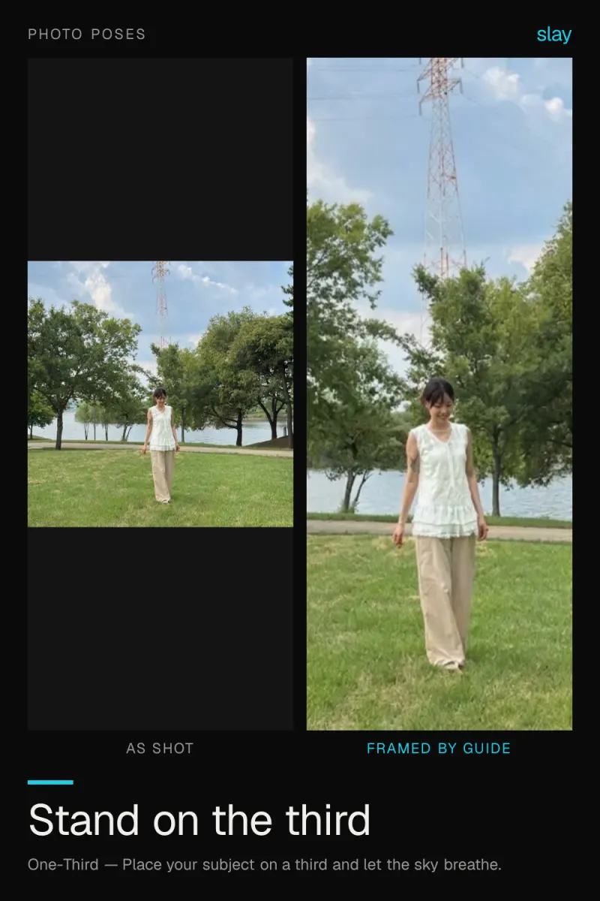
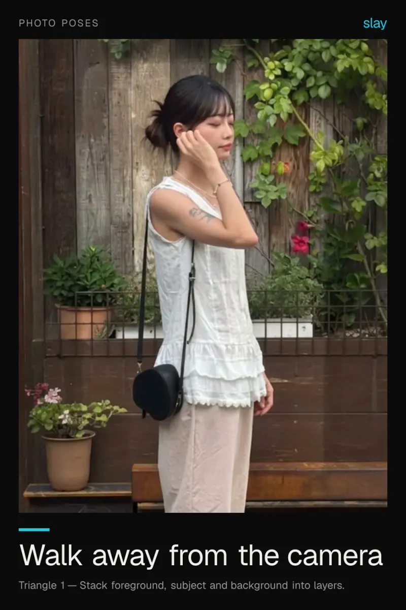
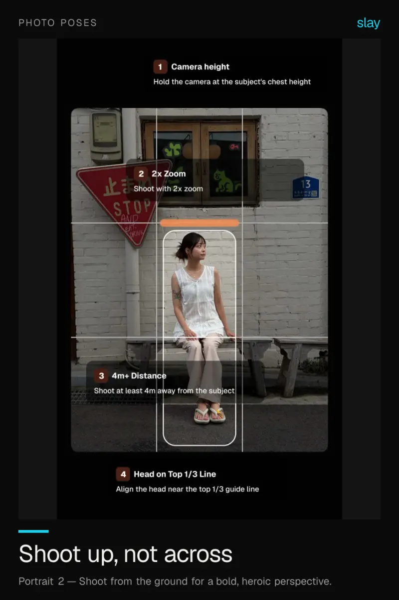

# Photo poses that stop looking staged

Most stiff posing is a framing problem, not a posing problem. Move the subject onto a third line, shoot from lower down, and ask them to walk — the pose fixes itself.

4 ideas · from [slay](https://www.slaycamera.com/photo-ideas/photo-poses?utm_source=github&utm_medium=repo&utm_campaign=photo-ideas) · CC BY 4.0

## 1. Photo Poses: The Seated Window Pose That Always Works

Seat your subject side-on to a window, put their eye line on the top third and leave room in front of them.

**Composition:** Place your subject on a third and let the sky breathe.

## 2. Photo Poses: Standing Poses That Look Natural on iPhone

Most stiffness is a framing problem. Move the subject onto a third line and the pose stops looking staged.

**Composition:** Place your subject on a third and let the sky breathe.

## 3. Photo Poses: Walking Shots Look Better Than Posing

Ask them to walk. Movement fixes stiff shoulders, and a walking subject gives you natural leading lines.

**Composition:** Stack foreground, subject and background into layers.

## 4. Photo Poses: The Low Angle Pose for Instant Drama

Kneel down and tilt up. The same pose reads as confident instead of casual, and full-body shots look longer.

**Composition:** Shoot from the ground for a bold, heroic perspective.

---

More: [Photo Poses on slaycamera.com](https://www.slaycamera.com/photo-ideas/photo-poses?utm_source=github&utm_medium=repo&utm_campaign=photo-ideas) ·
[All topics](../README.md) ·
[Frame these live with slay](https://apps.apple.com/app/id6807513456?utm_source=github&utm_medium=repo&utm_campaign=photo-ideas)
